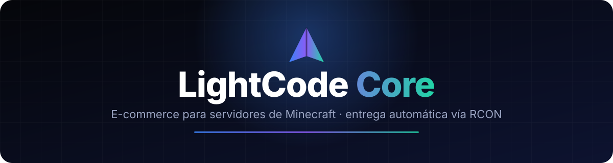
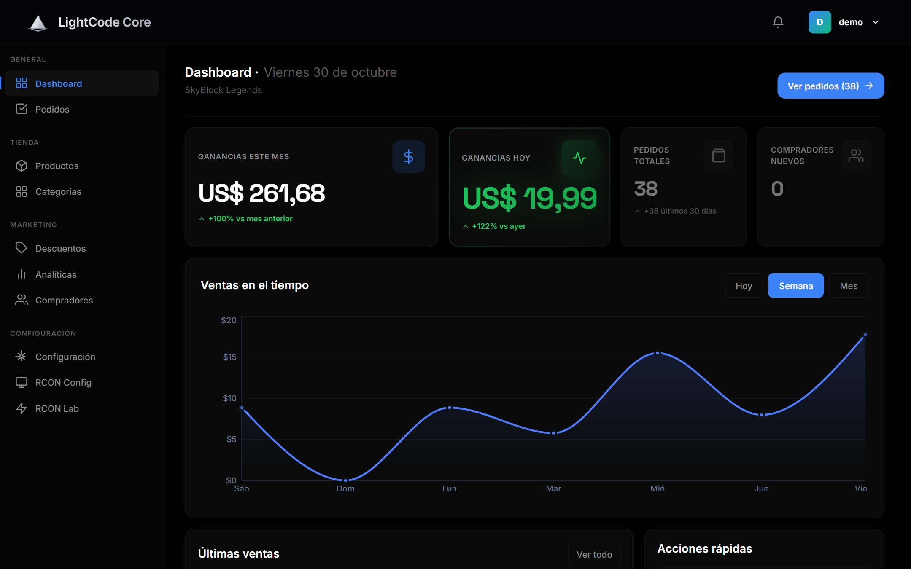
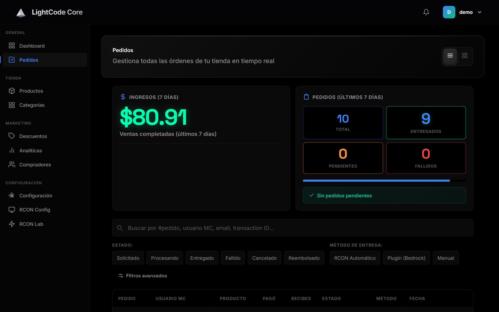
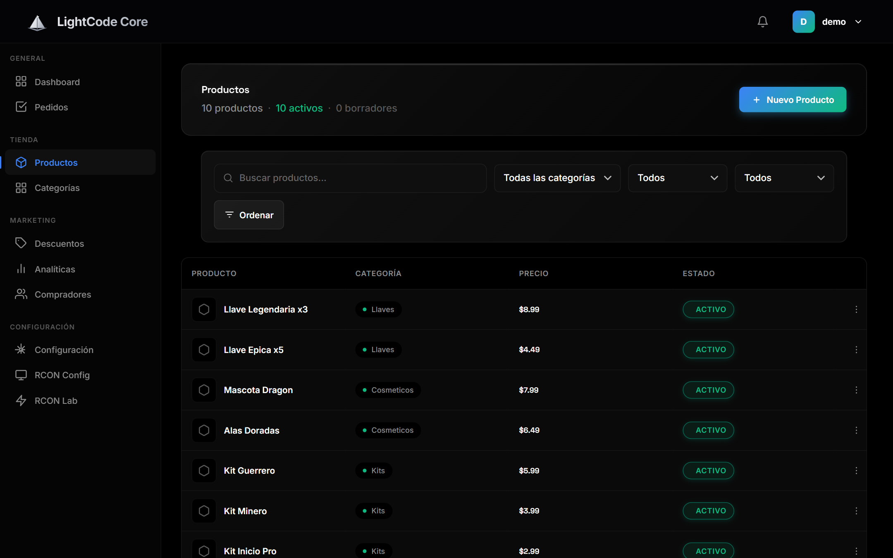
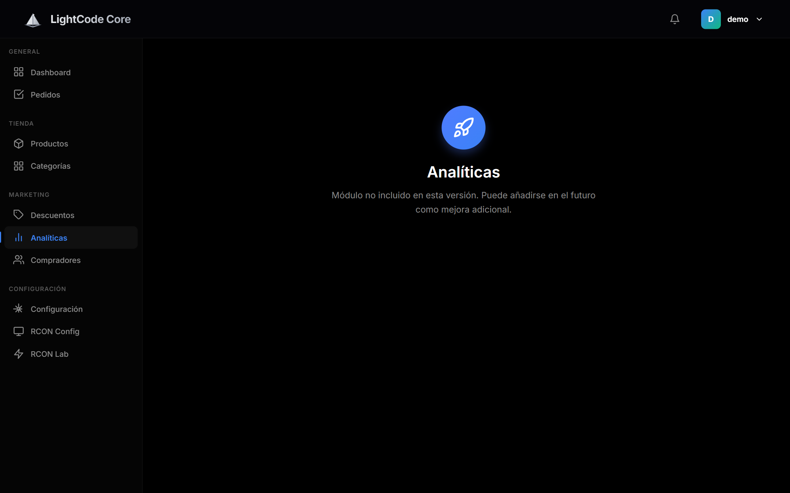
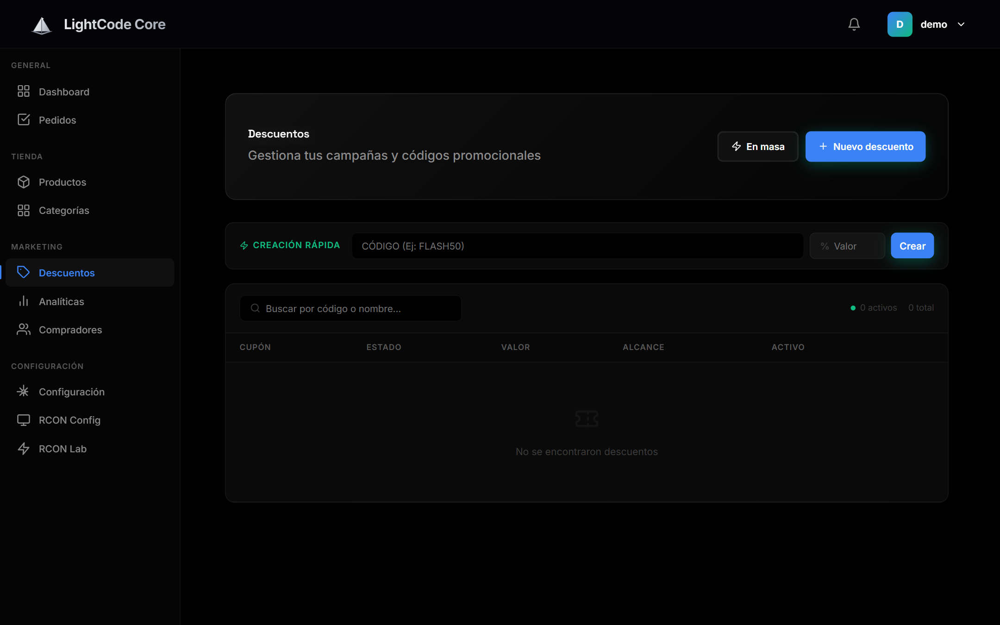
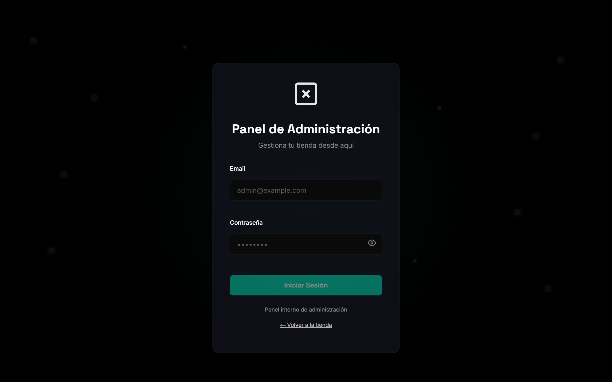
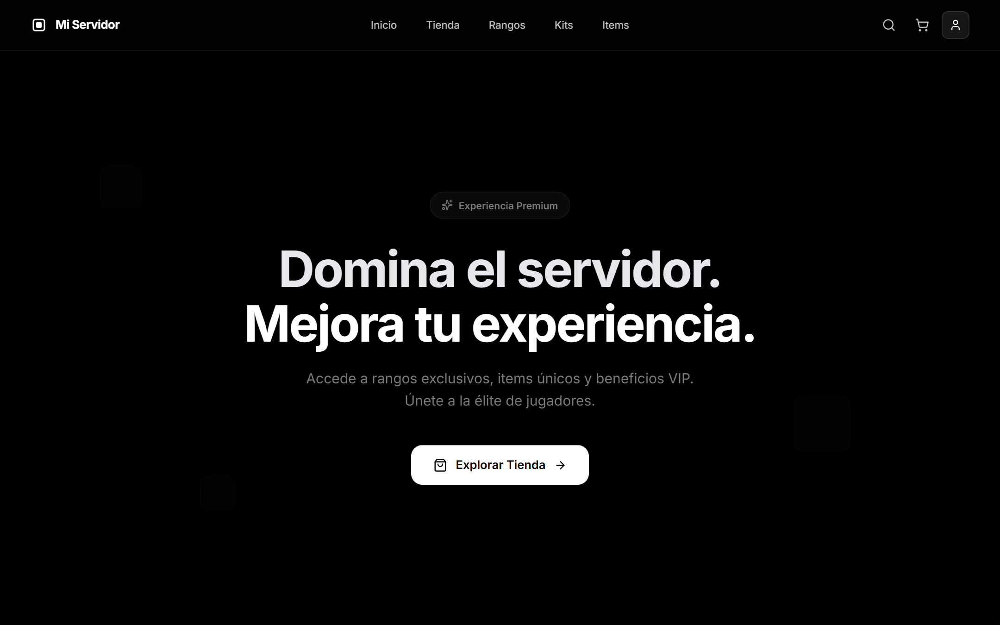
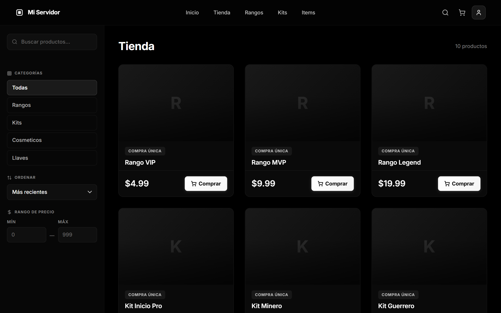
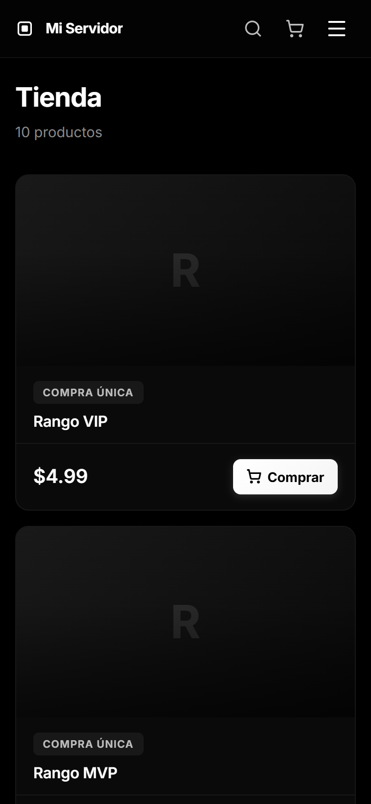

<div align="center">



<br/>

[](LICENSE)
[](#-licencia)


**Vende rangos, kits e ítems en tu servidor de Minecraft.**
**Cobra con PayPal, entrega automáticamente por RCON y quédate con tu dinero.**

[Capturas](#-capturas) · [Características](#-características) · [Instalación](#-instalación-rápida) · [Despliegue](#-despliegue) · [Licencia](#-licencia)

</div>

---

## 📸 Capturas

> Datos de demostración generados localmente (tienda ficticia "SkyBlock Legends").

### Panel de administración

<table>
  <tr>
    <td width="50%"><br/><sub><b>Dashboard</b> — ganancias, pedidos y ventas en el tiempo</sub></td>
    <td width="50%"><br/><sub><b>Pedidos</b> — estados, filtros y método de entrega</sub></td>
  </tr>
  <tr>
    <td width="50%"><br/><sub><b>Productos</b> — catálogo, categorías y comandos</sub></td>
    <td width="50%"><br/><sub><b>Analíticas</b> — rendimiento de la tienda</sub></td>
  </tr>
  <tr>
    <td width="50%"><br/><sub><b>Descuentos</b> — cupones individuales y masivos</sub></td>
    <td width="50%"><br/><sub><b>Acceso</b> — login del vendedor</sub></td>
  </tr>
</table>

### Tienda pública

<table>
  <tr>
    <td width="40%"><br/><sub><b>Inicio</b></sub></td>
    <td width="40%"><br/><sub><b>Catálogo</b> con filtros y búsqueda</sub></td>
    <td width="20%"><br/><sub><b>Móvil</b></sub></td>
  </tr>
</table>

---

## ✨ Características

**🏪 Tienda pública**
- Diseño oscuro y responsive (PC, tablet y móvil)
- Catálogo con categorías, filtros, búsqueda y orden por precio
- Carrito, cupones de descuento y checkout con PayPal
- Cuentas de comprador con historial de pedidos

**📊 Panel de administración**
- Dashboard con ganancias, pedidos y gráficos de ventas
- Productos con imágenes, galería, descripciones y comandos por evento
- Pedidos con estados, filtros y desglose de pagos y comisiones
- Cupones individuales y masivos, analíticas y compradores
- Notificaciones en tiempo real por WebSocket

**🚀 Entrega automática**
- Ejecución de comandos por **RCON** al confirmarse el pago (Java Edition)
- Soporte **Bedrock** mediante el plugin PlugsEssentials
- Cola de entregas con reintentos y logs por pedido
- Entrega manual como respaldo

---

## 🛠️ Stack

| Capa | Tecnología |
|------|-----------|
| Backend | Django 4.2 + Django REST Framework |
| Tiempo real | Channels + Daphne (WebSocket) |
| Tareas asíncronas | Celery + Redis |
| Base de datos | PostgreSQL (recomendado) / SQLite en desarrollo |
| Imágenes | Cloudinary |
| Pagos | PayPal |
| Frontend | React 19 + Vite + React Router |

---

## 🚀 Instalación rápida

**Requisitos:** Python 3.10+, Node.js 18+. Redis, PostgreSQL y Cloudinary son opcionales en desarrollo.

```bash
git clone https://github.com/Justin-Ocana/LightCode-Core.git
cd LightCode-Core
```

### 1. Backend

```bash
cd backend
python -m venv venv
source venv/bin/activate          # Windows: venv\Scripts\activate
pip install -r requirements.txt

cp .env.example .env              # Windows: copy .env.example .env
```

Edita `backend/.env` (como mínimo `SECRET_KEY` y `DEBUG=True` en local). Genera una clave con:

```bash
python -c "import secrets; print(secrets.token_urlsafe(50))"
```

Crea la base de datos y la tienda con su administrador:

```bash
python manage.py migrate
cd .. && python setup_whitelabel.py     # pide el nombre de tu tienda y genera las credenciales de admin
```

### 2. Frontend

```bash
cd frontend
npm install
cp .env.example .env              # Windows: copy .env.example .env
```

### 3. Ejecutar

```bash
# Terminal 1
cd backend && python manage.py runserver

# Terminal 2
cd frontend && npm run dev
```

| Qué | URL |
|-----|-----|
| Tienda | http://localhost:5173 |
| Panel admin | http://localhost:5173/admin/login |
| API | http://localhost:8000/api |

> Sin Redis, añade `CELERY_TASK_ALWAYS_EAGER=True` a `backend/.env`.

---

## ⚙️ Configuración

### PayPal
1. Crea una app en [PayPal Developer](https://developer.paypal.com) y copia Client ID y Secret.
2. Webhook: `https://tu-backend/api/payments/paypal/webhook/` con los eventos `PAYMENT.CAPTURE.COMPLETED` y `PAYMENT.CAPTURE.DENIED`.
3. Pon las credenciales en `backend/.env` (usa `PAYPAL_MODE=sandbox` para pruebas).

### RCON (Java Edition)
En el `server.properties` de tu servidor (hay un ejemplo en [`backend/server.properties.example`](backend/server.properties.example)):

```properties
enable-rcon=true
rcon.port=25575
rcon.password=tu-password-seguro
```

Reinicia el servidor y configura host, puerto y contraseña en **Panel → RCON Config**.

### Bedrock
Instala el plugin PlugsEssentials con el módulo Delivery y configura el token en el panel.

---

## 🌐 Despliegue

La combinación documentada es **Render** (backend + PostgreSQL) y **Vercel** (frontend). Las guías paso a paso están en [`docs/deployment/`](docs/deployment/):

- [Guía completa Vercel + Render](docs/deployment/GUIA_DESPLIEGUE_VERCEL_RENDER.md)
- [Quickstart Render](docs/deployment/RENDER_QUICKSTART.md) · [Quickstart Vercel](docs/deployment/VERCEL_QUICKSTART.md)
- [Checklist de despliegue](docs/deployment/CHECKLIST_DESPLIEGUE.md)

También incluye `Dockerfile`, `docker-compose.yml` y `render.yaml`.

### 🔒 Antes de publicar tu tienda
- [ ] `SECRET_KEY` único y `DEBUG=False`
- [ ] `ALLOWED_HOSTS` y `CORS_ALLOWED_ORIGINS` correctos, y HTTPS activo
- [ ] Nunca subas `.env`, `.admin_credentials` ni bases de datos a Git
- [ ] `PAYPAL_MODE=live` solo cuando hayas probado en sandbox

---

## 📁 Estructura

```
LightCode-Core/
├── backend/                # Django + DRF
│   ├── apps/               # users, stores, products, orders, payments, discounts, ...
│   ├── core/               # utilidades, RCON, WebSocket, middleware
│   └── settings/           # base / development / staging / production
├── frontend/               # React + Vite
│   └── src/                # pages, components, context, services
├── docs/                   # capturas y guías de despliegue
└── setup_whitelabel.py     # asistente de primera configuración
```

---

## 🤝 Contribuir

Los issues y pull requests son bienvenidos. Al enviar una contribución aceptas que se distribuya bajo la misma licencia del proyecto.

---

## 📄 Licencia

Este proyecto es **open source** bajo la [licencia MIT](LICENSE).

Puedes usarlo, modificarlo y distribuirlo libremente, **incluso para montar tu propia tienda y ganar dinero con ella**. Solo te pido que mantengas el aviso de copyright y la licencia en las copias del código.

Si te sirve, una ⭐ al repositorio se agradece mucho.

---

<div align="center">

Hecho con ⚡ por [Justin Ocana](https://github.com/Justin-Ocana) · Para la comunidad de Minecraft

</div>
